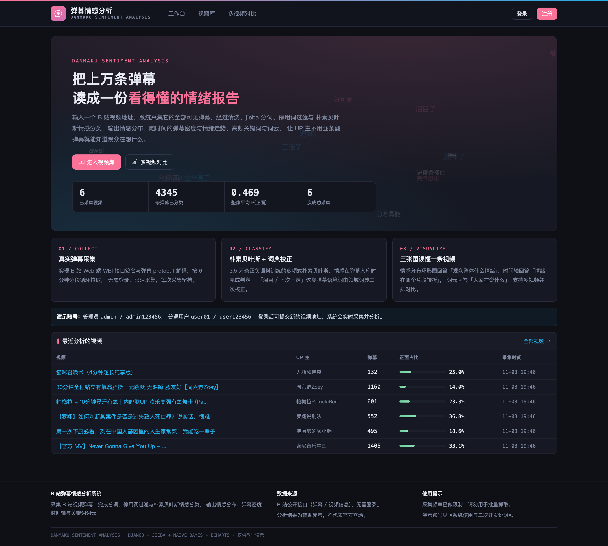
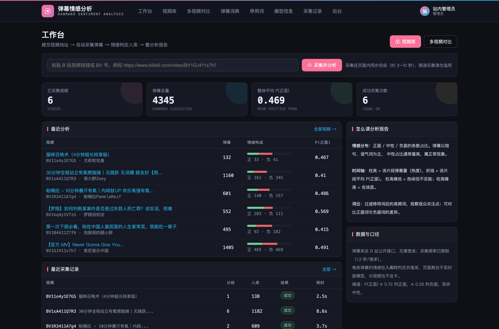
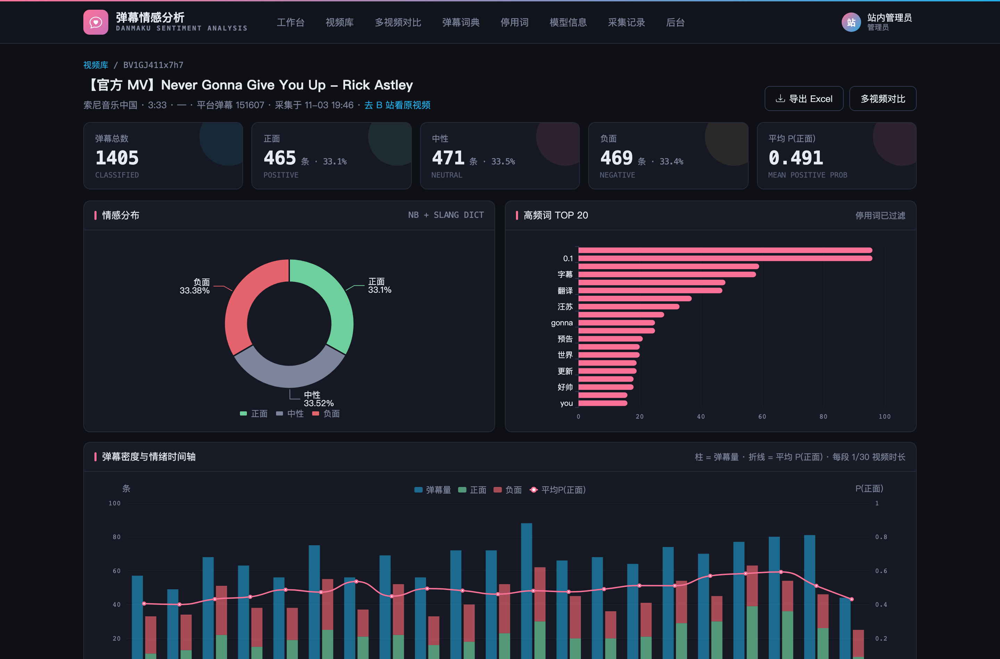
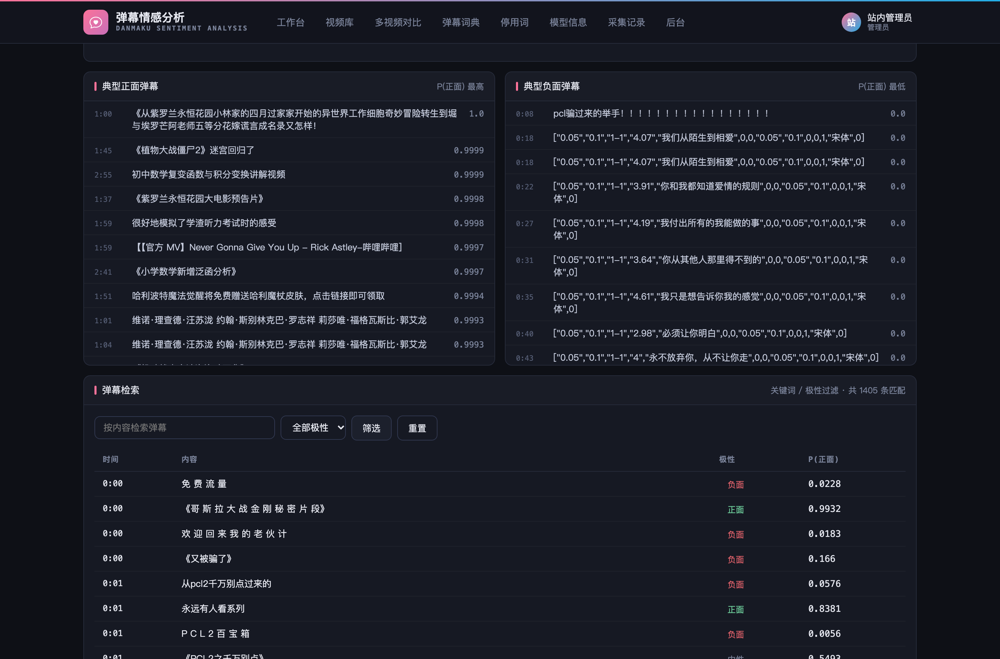
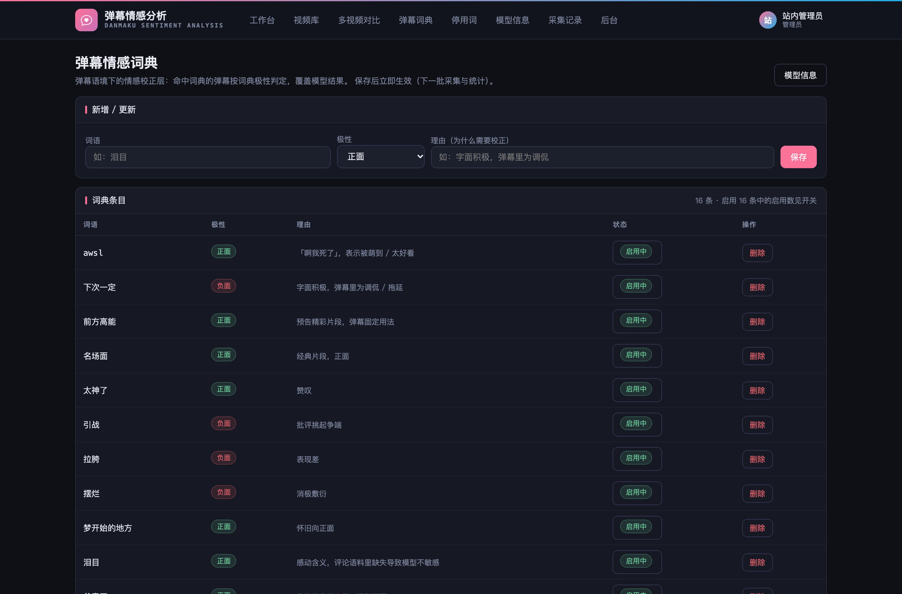
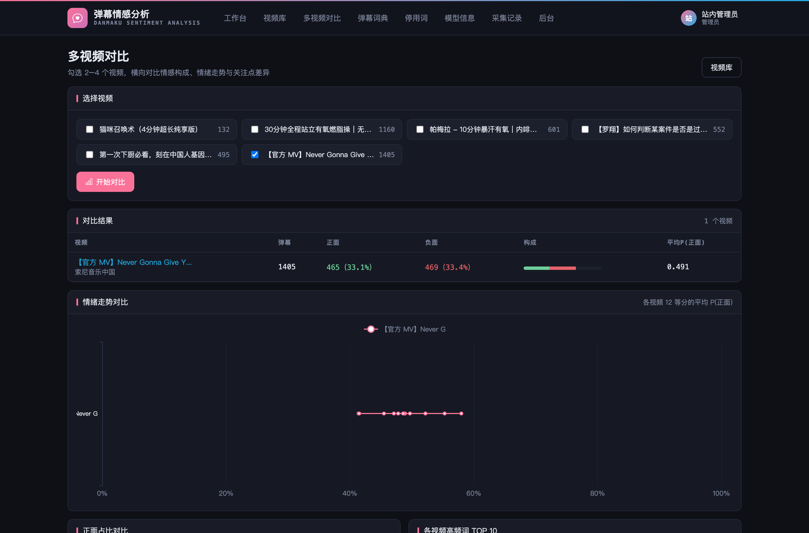
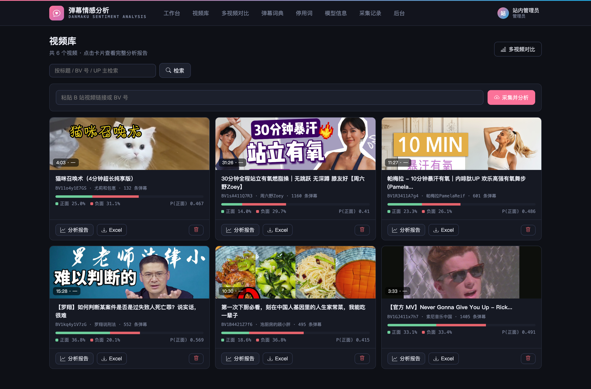
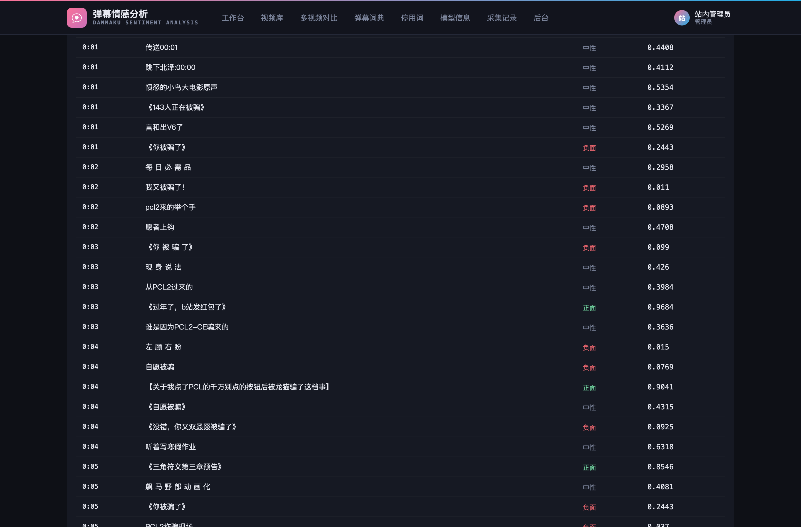
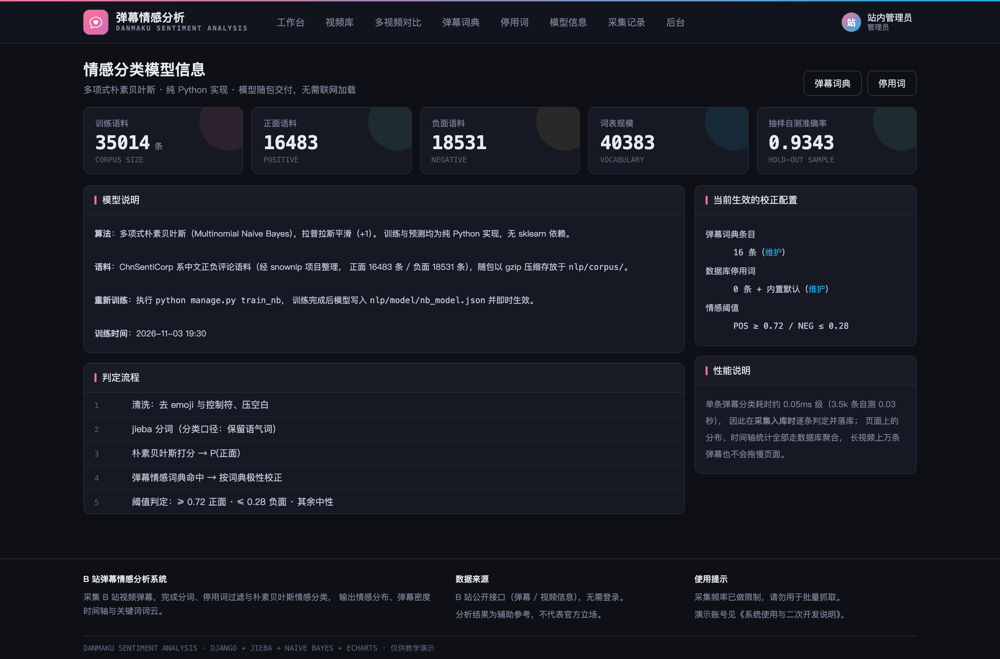
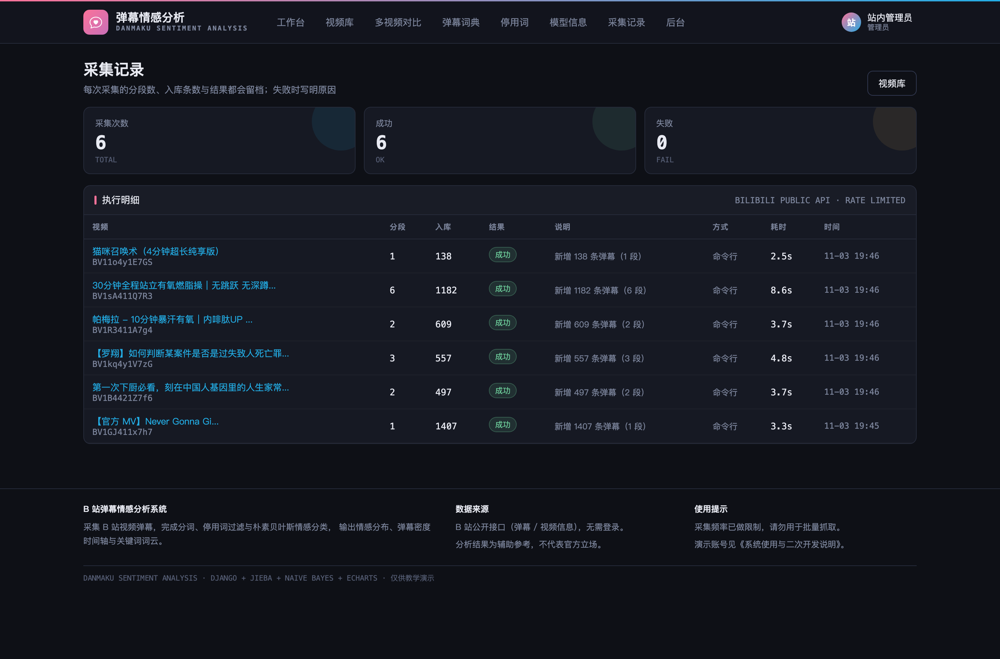

# 009 基于 Django 的 B 站弹幕情感分析系统-设计展示

> **代码有偿获取 可接受定制 微信联系方式: csbysj2020 或 ACE2487，备注(BS)**

> **完整源码与全套文档 · 在线自助获取 >>> [https://mbd.pub/o/bread/YZaWlJ1saQ==](https://mbd.pub/o/bread/YZaWlJ1saQ==)**

> **成品页（功能介绍 / 更多选题）>>> [https://bishe.suilang.net/products/django-danmaku-sentiment](https://bishe.suilang.net/products/django-danmaku-sentiment)**

> 

> 

## 视频

> **点击查看 >>> [https://www.bilibili.com/video/BV1in4G6hEm9/](https://www.bilibili.com/video/BV1in4G6hEm9/)**

## 项目简介

面向 UP 主与内容研究者的弹幕情感分析系统：粘贴 B 站视频地址即可采集其全部可见弹幕（自实现 WBI 接口签名与 protobuf 解码，无需登录），经清洗、jieba 分词、停用词过滤与朴素贝叶斯情感分类，输出情感分布、弹幕密度与情绪时间轴、高频关键词与词云；弹幕语境词由可维护的情感词典二次校正，支持多视频对比与 Excel 导出。

弹幕是视频平台上最具特色的用户行为：观众的情绪、梗与吐槽以短文本形式实时叠加在画面上，是创作者了解反馈最直接的渠道。

但弹幕动辄上万条，人工阅读既不现实也不客观；弹幕接口需要参数签名且返回二进制编码，文本高度口语化，通用情感模型在弹幕语境下误判明显。

针对这些问题，本项目设计并实现了一套基于 Django 的 B 站弹幕情感分析系统。

本仓库为**设计展示**：包含项目说明、技术架构、实验结果与运行截图；完整源码、任务书、开题报告、毕业论文与使用说明可通过上方链接自助获取，成品页可查看更多选题，也可联系微信咨询定制。

## 功能特性

1. 真实弹幕采集：自实现 B 站 WBI 接口签名与弹幕 protobuf 解码，无需登录，按 6 分钟分段限速拉取

2. 朴素贝叶斯情感分类：3.5 万条正负语料训练（纯 Python 实现，拉普拉斯平滑），模型随包交付

3. 弹幕情感词典校正层：「泪目 / 下次一定」等弹幕语境词按人工极性覆盖模型结果，规则带理由可维护

4. 分析报告：情感分布环形图、弹幕密度 + 情绪双轴时间轴、高频词 TOP20、关键词词云

5. 典型样例与检索：P(正面) 最高的正面 / 负面弹幕样例，按内容与极性检索弹幕

6. 多视频对比：2–4 个视频的情感构成、情绪走势与高频词横向对比

7. 维护页面：弹幕词典与停用词增删即时生效；模型信息展示语料规模与判定流程

8. 采集记录与导出：分段数 / 条数 / 耗时 / 结果全程留档；四张工作表 Excel 导出

## 技术架构

| 项目 | 说明 |
| --- | --- |
| 编程语言 | Python 3.8 及以上 |
| Web 框架 | Django 4.2 |
| 中文分词 | jieba |
| 情感分类 | 多项式朴素贝叶斯（纯 Python 自实现，模型随包交付） |
| 数据采集 | B 站公开接口（自实现 WBI 签名与 protobuf 解码，无需登录） |
| 数据库 | MySQL 5.7 及以上（交付默认 SQLite，免安装） |
| 可视化 | ECharts 5 + wordcloud（已内置本地文件，离线可用） |
| 报表导出 | openpyxl |
| 操作系统 | Windows / macOS / Linux |
| 启动方式 | 双击一键脚本，或 python manage.py runserver |

## 目录结构

以下为完整交付版的结构（本仓库仅作设计展示）：

```
django-danmaku-sentiment/
├── 任务书/
│   └── 毕业设计任务书.docx
├── 开题报告/
│   └── 毕业设计开题报告.docx
├── 最终论文/
│   ├── 图/
│   │   ├── 图3-1_系统用例图.png
│   │   ├── 图4-1_系统架构图.png
│   │   ├── 图4-2_功能模块图.png
│   │   ├── 图4-3_情感判定流程图.png
│   │   ├── 图4-4_数据库ER图.png
│   │   └── 图4-5_弹幕采集流程图.png
│   └── 基于Django的B站弹幕情感分析系统设计.docx
├── 源码/
│   ├── accounts/
│   │   ├── migrations/
│   │   ├── __init__.py
│   │   ├── admin.py
│   │   ├── apps.py
│   │   ├── forms.py
│   │   ├── models.py
│   │   ├── urls.py
│   │   └── views.py
│   ├── danmuplat/
│   │   ├── asgi.py
│   │   ├── settings.py
│   │   ├── urls.py
│   │   └── wsgi.py
│   ├── nlp/
│   │   ├── corpus/
│   │   ├── data/
│   │   ├── management/
│   │   ├── migrations/
│   │   ├── model/
│   │   ├── __init__.py
│   │   ├── admin.py
│   │   ├── apps.py
│   │   ├── models.py
│   │   ├── services.py
│   │   ├── urls.py
│   │   └── views.py
│   ├── static/
│   └── …
└── …
```

## 数据与实验结论

- 测试结果表明：系统功能完整，采集链路在多个视频上稳定运行，情感判定抽样准确率达 93.4%，词典校正对弹幕语境词的误判有明显改善，长视频分析页面响应流畅，达到了设计目标。
- 真实弹幕采集：自实现 B 站 WBI 接口签名与弹幕 protobuf 解码，无需登录，按 6 分钟分段限速拉取
- 朴素贝叶斯情感分类：3.5 万条正负语料训练（纯 Python 实现，拉普拉斯平滑），模型随包交付
- 分析报告：情感分布环形图、弹幕密度 + 情绪双轴时间轴、高频词 TOP20、关键词词云

## 交付内容

1. 完整源码（已跑通，含 6 个真实视频、4300+ 条已分类弹幕的演示库）
2. 训练好的朴素贝叶斯模型与训练语料（可重新训练）
3. B 站采集模块（WBI 签名 + protobuf 解码，可独立复用）
4. 毕业设计任务书（Word）
5. 开题报告（Word）
6. 毕业论文（Word，七章制，含采集设计与情感判定设计章节）
7. 系统使用与二次开发说明（Word + md）
8. 10 张系统运行截图

## 常见问题

**项目能直接跑起来吗？**

能。交付包里已带数据库（6 个真实视频、4300+ 条已分类弹幕），安装依赖后双击一键脚本即可；想采新视频需要联网，无需登录 B 站。

**弹幕是真实数据吗？**

是。弹幕与视频信息来自 B 站公开接口，系统自实现了 WBI 接口签名与 protobuf 解码；每次采集的分段数、条数、耗时都会在「采集记录」留档。

**为什么弹幕数比平台显示的少？**

B 站接口对历史弹幕有回放上限，系统采集到的是接口当前返回的可见部分，页面上如实展示条数。

**情感判定准不准？**

训练语料留出自测准确率 93.4%；真实弹幕人工抽查中，明确正负面弹幕准确率约 85%。弹幕多为短句与语气词，中性占比高属正常；每条弹幕保留 P(正面) 可核查。

**「泪目」「下次一定」这类词怎么处理？**

通用评论语料里缺少或语义反转这类弹幕用语，系统设计了弹幕情感词典校正层：命中即按人工极性覆盖模型结果，每条规则带理由、可在页面维护。

**为什么没有实时分析大按钮？**

情感在弹幕入库时逐条判定并落库（单条约 0.05ms），页面聚合走数据库索引——长视频万级弹幕也不会卡页面；这也符合真实系统的做法。

## 截图











